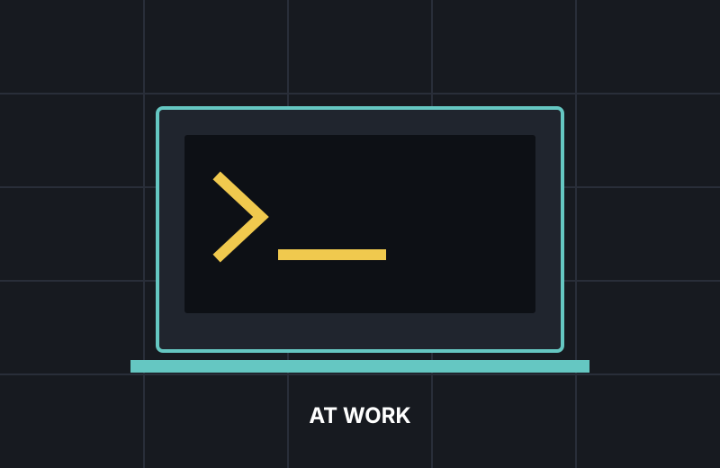
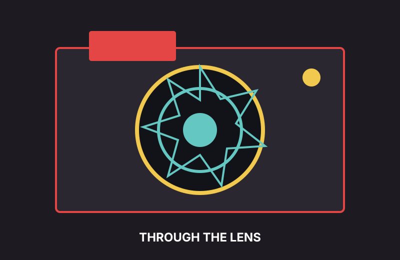

  

## Hello, I'm Elizar.

I am a software engineer, technology consultant, and entrepreneur based in Switzerland. I build useful digital products where **AI, enterprise processes, and thoughtful user experience** meet.

With a Bachelor's degree in Computer Science from a Swiss university and experience at a Swiss enterprise consultancy, I turn ambiguous business problems into systems people can actually use.

- Building AI-assisted applications and enterprise workflow automation
- Working across product thinking, architecture, implementation, and deployment
- Exploring how AI changes the way software is designed and delivered

<table>
  <tr>
    <td width="33%"></td>
    <td width="33%"></td>
    <td width="33%"></td>
  </tr>
  <tr>
    <td align="center"><strong>Building</strong> From idea to production</td>
    <td align="center"><strong>Travelling</strong> Finding new perspectives</td>
    <td align="center"><strong>Photography</strong> Training the eye</td>
  </tr>
</table>

## Selected work

### [Purchase Request Automation](https://github.com/elizarpongracz/blp-poc-elizar)

An AI-first proof of concept that turns unstructured purchase requests into a controlled, auditable enterprise workflow. It combines intelligent data extraction, master-data enrichment, BPMN-based routing, approvals, task queues, and a live process view.

`Next.js` `TypeScript` `PostgreSQL` `BPMN` `Gemini` `Railway`

## What I work with

| Product engineering | Cloud and delivery | Enterprise workflows | AI development |
| --- | --- | --- | --- |
| TypeScript, Next.js, React | GCP, Azure, Railway | Flowable, Camunda | Codex, Claude Code |
| Java, Spring Boot, SQL | Git, CI/CD | BPMN, process automation | OpenCode, AI APIs |
| Angular, PostgreSQL | Production deployment | Systems integration | Zed, IntelliJ IDEA |

## Beyond software

I enjoy travelling, photography, and pushing the boundaries of what AI can make possible. Each rewards the same habit: look closely, question the default, and find a better frame.

## Let's talk

I am open to conversations about consulting, product collaboration, enterprise automation, and practical AI.

**[elizarpongracz@gmail.com](mailto:elizarpongracz@gmail.com)**
