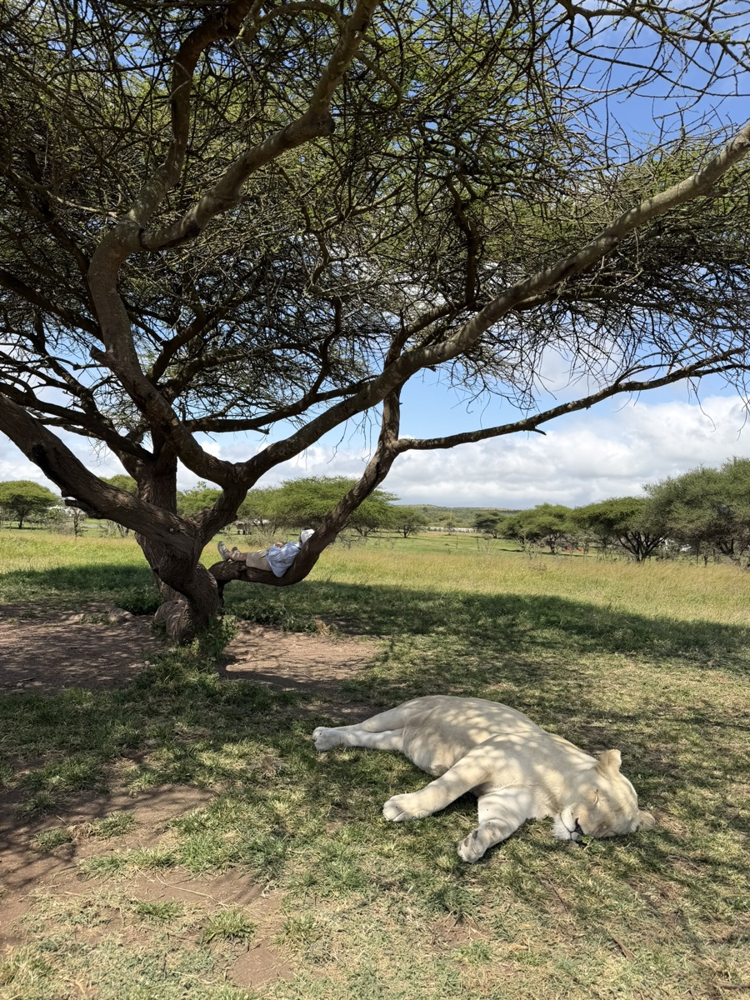
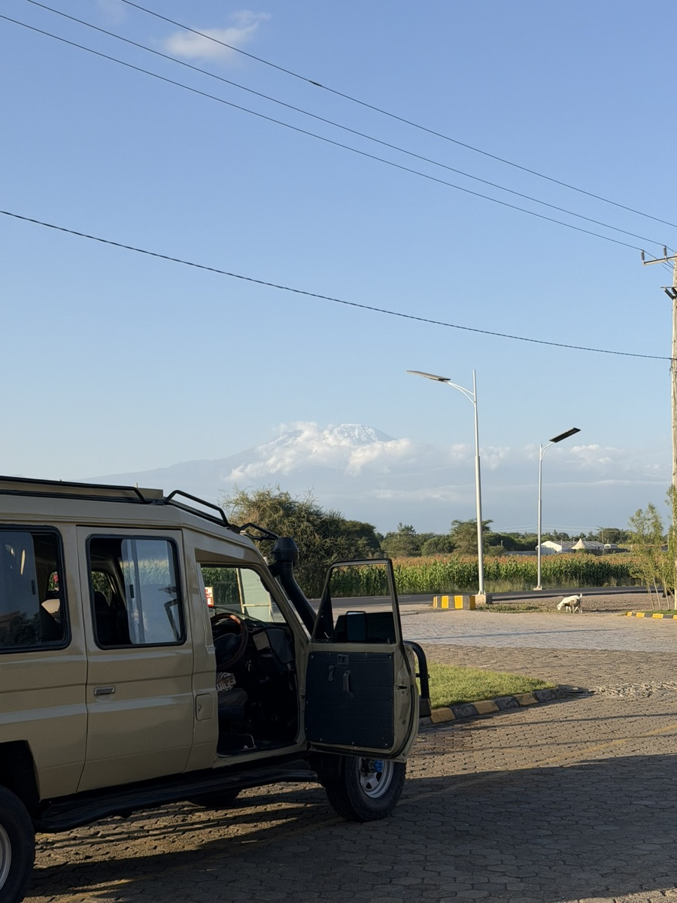

## Hi, I'm Elizar

I live in Zurich and write software for a living. Most of it is AI-assisted applications and automation for enterprise processes.

I studied computer science at a Swiss university and then worked at a Swiss enterprise consultancy. Now I work as a technology consultant and run my own projects.

<table>
  <tr>
    <td width="33%"></td>
    <td width="33%"></td>
    <td width="33%"></td>
  </tr>
  <tr>
    <td align="center"><strong>Building</strong> Working late, city view</td>
    <td align="center"><strong>Travelling</strong> Resting in a tree</td>
    <td align="center"><strong>Photography</strong> A mountain and a safari truck</td>
  </tr>
</table>

When I'm not working, I travel and take photos. I also try out new AI tools to see what they can build.

If you want to talk about a project, email [elizarpongracz@gmail.com](mailto:elizarpongracz@gmail.com).
